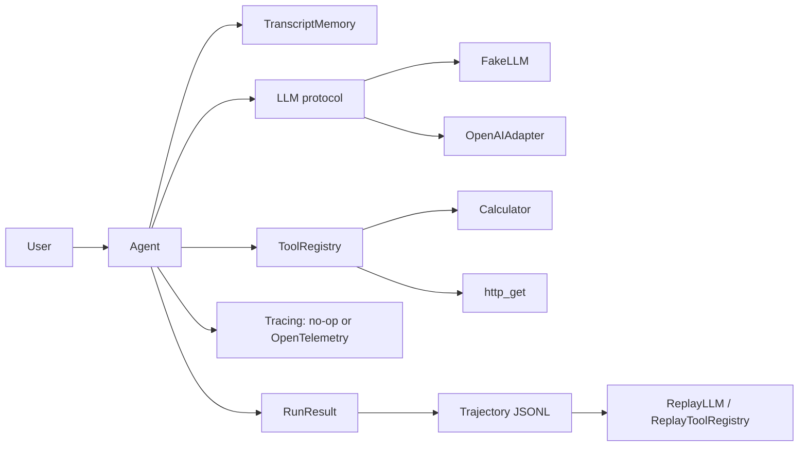

# agent-runtime-kit

A small Python agent loop with a tool registry, a pluggable LLM interface, transcript memory, optional OpenTelemetry tracing, and record/replay of agent trajectories for regression tests. No framework, no graph DSL: the core loop is one file you can read in one sitting, and the core package has no runtime dependencies.

## Why

Most agent frameworks hide the core loop behind abstractions. I wanted a minimal, tested version of that loop (call the model, run the requested tools, feed results back, stop on a final answer or a step limit) with a deterministic `FakeLLM`, so tool wiring can be tested in CI without an API key.

## Features

- **Agent loop** — messages, `max_steps`, tool registry (`@tool` / `register`), `RunResult` with steps, tool calls, final text, latency counters
- **Built-in tools** — `calculator` (AST-safe arithmetic) and `http_get` (timeout + size limit)
- **Pluggable LLM** — `LLM` protocol, `FakeLLM` for deterministic tests/demos, optional `OpenAIAdapter` behind `OPENAI_API_KEY`
- **Short-term memory** — ordered transcript buffer across steps
- **Token usage** — per-call and per-run `Usage` (input, output, cache-read, reasoning tokens) plus the model that served each response; mapped from OpenAI usage fields in the adapter
- **OpenTelemetry tracing (optional)** — `invoke_agent`, `chat` and `execute_tool` spans following the GenAI semantic conventions, with token usage on every model call
- **Trajectories** — record a run as JSONL, replay it offline with `ReplayLLM` / `ReplayToolRegistry`, and diff runs against golden files
- **Golden evals** — fixed FakeLLM scenarios with expected tool use and answers, plus golden trajectory files
- **OTLP/JSON export** — turn finished spans into collector-ready OTLP/JSON, used to produce fixtures for [otel-genai-cost](https://github.com/gratycodes/otel-genai-cost)
- **CI** — GitHub Actions runs pytest on Python 3.11–3.13 without OpenTelemetry, and again with the `otel` extra

## Architecture



**Loop (simplified):**

1. Append user message to memory
2. Call `llm.complete(messages, tools)`
3. If the assistant returns `tool_calls`, invoke each tool, append tool results, repeat
4. Otherwise treat content as the final answer and return `RunResult`
5. Stop early on `max_steps`

## Install

```bash
# clone
git clone https://github.com/gratycodes/agent-runtime-kit.git
cd agent-runtime-kit

python -m venv .venv
source .venv/bin/activate
pip install -e ".[dev]"

# optional OpenAI support
pip install -e ".[openai]"

# optional OpenTelemetry tracing and OTLP/JSON export
pip install -e ".[otel]"
```

Requires **Python 3.11+**.

## Demo

Deterministic FakeLLM scenario (no API key required):

```bash
python -m agent_runtime.demo
```

Expected shape of output: a calculator tool call for `(17 + 25) * 3`, then a final answer of `126`.

## Quick start (library)

```python
from agent_runtime import Agent, FakeLLM, FakeTurn, built_in_registry

llm = FakeLLM(
    script=[
        FakeTurn(
            tool_calls=[{
                "name": "calculator",
                "arguments": {"expression": "6 * 7"},
            }]
        ),
        FakeTurn(content="42"),
    ]
)
agent = Agent(llm=llm, tools=built_in_registry())
result = agent.run("What is 6*7?")
print(result.final_text)       # 42
print(result.tool_calls)       # [ToolCall(name='calculator', ...)]
print(result.total_latency_ms)
```

### Optional OpenAI

```python
import os
from agent_runtime import Agent, OpenAIAdapter, built_in_registry

assert os.environ.get("OPENAI_API_KEY"), "set OPENAI_API_KEY"
agent = Agent(llm=OpenAIAdapter(model="gpt-4o-mini"), tools=built_in_registry())
print(agent.run("What is 19*21?").final_text)
```

## Tracing (optional)

Install the `otel` extra, then pass a `GenAITracing` to the agent. Without it
the agent uses a no-op tracer and never imports OpenTelemetry.

```python
from opentelemetry.sdk.trace import TracerProvider
from opentelemetry.sdk.trace.export import ConsoleSpanExporter, SimpleSpanProcessor

from agent_runtime import Agent, OpenAIAdapter, built_in_registry
from agent_runtime.tracing import GenAITracing

provider = TracerProvider()
provider.add_span_processor(SimpleSpanProcessor(ConsoleSpanExporter()))

agent = Agent(
    llm=OpenAIAdapter(model="gpt-4o-mini"),
    tools=built_in_registry(),
    name="math-helper",
    tracing=GenAITracing(provider, attributes={"feature": "calculator-demo"}),
)
agent.run("What is 19*21?", trace_attributes={"tenant.id": "tenant-a"})
```

One run produces this span tree:

```
invoke_agent math-helper        INTERNAL  gen_ai.usage.* summed over the run
├── chat gpt-4o-mini            CLIENT    gen_ai.request.model, gen_ai.response.model,
│                                         gen_ai.usage.input_tokens / output_tokens /
│                                         cache_read.input_tokens / reasoning.output_tokens,
│                                         gen_ai.response.finish_reasons
├── execute_tool calculator     INTERNAL  gen_ai.tool.name, gen_ai.tool.call.id, error.type on failure
└── chat gpt-4o-mini            CLIENT
```

Attribute names follow the [GenAI semantic conventions](https://github.com/open-telemetry/semantic-conventions-genai).
Prompts and completions are never recorded. Tool arguments and results are
recorded only with `GenAITracing(..., capture_tool_content=True)`.
`attributes` and `trace_attributes` are copied onto every span, which is how
downstream tools attribute cost to a feature or tenant.

Note that `invoke_agent` carries the summed usage of its `chat` children, as
the conventions allow. Anything that sums tokens or cost across spans should
count `chat` spans only.

## Record, replay and golden trajectories

```python
from agent_runtime import Agent, ReplayLLM, ReplayToolRegistry, Trajectory, diff_trajectories

# Record once (for example against a real model)
result = agent.run(question)
Trajectory.from_run(question, result).write("refund_case.jsonl")

# Replay offline: recorded model responses, recorded tool outputs, no API key, no side effects
recorded = Trajectory.read("refund_case.jsonl")
replay = Agent(llm=ReplayLLM(recorded), tools=ReplayToolRegistry(recorded, specs_from=agent.tools))
replayed = replay.run(question)

# Regression check: empty list means same behaviour
assert diff_trajectories(recorded, Trajectory.from_run(question, replayed)) == []
```

Each JSONL line is one event: a `run` header, an `llm` record per model
response (content, tool calls, usage, model), a `tool` record per tool result,
and a final `result`. `ReplayToolRegistry` raises `TrajectoryMismatch` if the
agent calls a different tool or passes different arguments than recorded.
`diff_trajectories` ignores latency, and by default also ignores generated
tool-call ids and token usage.

`tests/test_trajectory.py` runs five scripted scenarios (single tool call,
parallel calls, recovery from a tool error, no tool, hitting `max_steps`) and
compares each with its golden file in `tests/golden/`. After an intentional
change, regenerate them with:

```bash
UPDATE_GOLDEN=1 pytest tests/test_trajectory.py
```

## Exporting traces as OTLP/JSON

```bash
pip install -e ".[otel]"
python examples/export_otlp_traces.py examples/fixtures/agent_runs.otlp.json
```

The example runs two scripted support-bot conversations (synthetic orders,
FakeLLM with scripted token usage, made-up `example-*` model names) and writes
the spans as an OTLP/JSON document, the same format an OTLP/HTTP exporter
sends. [otel-genai-cost](https://github.com/gratycodes/otel-genai-cost) uses a
copy of this output as a test fixture to price the `chat` spans per feature
and tenant.

## Tests

```bash
pytest -q
```

Coverage includes:

- Agent loop (final answer, tool use, unknown tool, max_steps)
- Tool selection / calculator safety
- **3 golden eval cases** (`simple_arithmetic`, `nested_expression`, `no_tool_needed`)
- Token usage accounting and OpenAI usage mapping
- Span names, kinds, parent/child structure and GenAI attributes; error marking for tool failures, unknown tools and model exceptions; a check that the core never imports OpenTelemetry
- Trajectory JSONL round-trip, replay without running tools, mismatch detection, and **5 golden trajectories**
- OTLP/JSON export (hex ids, integer enums, int64-as-string)

Tests that need OpenTelemetry are skipped when the `otel` extra is not installed.

## Design notes

| Choice | Why |
| --- | --- |
| Plain loop, not a graph | Interviewers can read the control flow without a framework mental model |
| `LLM` protocol + `FakeLLM` | Tests and demos stay deterministic; OpenAI is optional |
| AST calculator | Safer than `eval`; still shows tool-use plumbing |
| Bounded `http_get` | Timeout + byte cap so demos cannot hang or buffer large bodies |
| `RunResult` counters | Latency and step traces make behavior inspectable |
| Golden evals | Small, fixed scenarios that fail loudly if tool wiring regresses |
| Tracing behind a protocol | The loop calls a tiny tracing interface; the no-op default keeps the core dependency-free |
| Usage on `chat`, not only on the agent span | Per-call tokens are what cost tools need; agent totals alone would hide which model call was expensive |
| JSONL trajectories | One event per line diffs well in code review and can be appended while a run is in progress |

## Limitations

- Single agent only: no multi-agent orchestration, planning, or streaming.
- Memory is an in-process transcript; nothing is persisted between runs.
- `http_get` checks the URL scheme, timeout (5 s) and size (50 KB) but does not block private or internal addresses, so do not expose it to untrusted input.
- The OpenAI adapter is optional and not exercised in CI; tests use `FakeLLM`.
- Golden evals and golden trajectories check tool selection, arguments and final answers for fixed scripted scenarios; they are regression tests, not a model-quality benchmark.
- Replay is strict and sequential: a run that legitimately takes a different path (for example after a prompt change) fails replay and needs re-recording.
- Trajectories are built from the finished `RunResult`, so a run that raises an exception is not recorded.
- Tracing covers the agent loop only. It does not record prompts or completions, streaming, or `gen_ai.client.*` metrics.
- `FakeLLM` token counts are whatever the script says; they are not estimated from text.

## Stack

Python 3.11+ (standard library only for the core), optional `openai` SDK, optional OpenTelemetry API/SDK and OTLP protobuf encoder, pytest, Hatchling, GitHub Actions (Python 3.11, 3.12, 3.13).

## Project layout

```
src/agent_runtime/
  agent.py      # multi-step loop
  tools.py      # registry + calculator + http_get
  llm.py        # protocol, FakeLLM, OpenAIAdapter
  memory.py     # short-term transcript
  types.py      # Message, ToolCall, Step, RunResult, Usage
  tracing.py    # NoopTracing + optional GenAITracing (OpenTelemetry)
  trajectory.py # JSONL record/replay and diff
  otlp_json.py  # spans -> OTLP/JSON
  demo.py       # python -m agent_runtime.demo
examples/
  export_otlp_traces.py
  fixtures/agent_runs.otlp.json
tests/
  test_agent.py, test_tools.py, test_golden_evals.py
  test_usage.py, test_tracing.py, test_tracing_core.py
  test_trajectory.py, scenarios.py, golden/*.jsonl
  test_otlp_export.py
```

## License

MIT, see [LICENSE](LICENSE).
